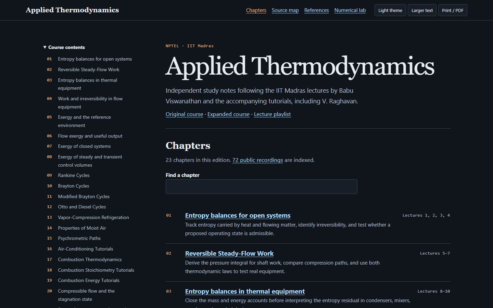

# Applied Thermodynamics

Independent study notes for NPTEL Applied Thermodynamics at IIT Madras. The notes follow Prof. Babu Viswanathan’s lectures and the accompanying tutorials, including those taught by Prof. V. Raghavan.

These notes are not endorsed by NPTEL and are not associated with NPTEL in any way.

[Read the book](https://az9713.github.io/nptel-applied-thermodynamics-notes/) · [Source map](source-map.html) · [Numerical lab](code-lab.html) · [References](references.html)

The 23 chapters cover control-volume entropy, exergy, power and refrigeration cycles, psychrometry, combustion thermodynamics, and compressible flow. They include section-level recording links, derived balances, 93 worked problems, and 23 numerical labs. The dark-mode HTML reader uses local styles and MathJax. Download or clone the repository and open [index.html](index.html) for offline reading.

## Course sources

The supplied YouTube playlist has 73 entries. The [source map](source-map.html) maps 72 public recordings to chapters. The original Psychrometry Part 5 at position 43 is private. The expanded course uses the public recording at position 73 for the same topic. The chapter places it between Parts 4 and 6. [Original IIT Madras catalog](https://nptel.ac.in/courses/112106314) · [Expanded IIT Madras catalog](https://nptel.ac.in/courses/112106419) · [YouTube playlist](https://www.youtube.com/playlist?list=PLbMVogVj5nJRgXRZ0xEoBfWELmSo6JvvZ)

The English captions give the topic order and timestamp locators. The notes reconstruct the reasoning and mark original numerical cases when they replace a lecture’s example. Visual checks use sampled frames. Course recordings and their captions remain with their rights holders. This is an independent study edition.

## Rebuild and verify

~~~powershell
python -m pip install -r tools/requirements.txt
python tools/build_reader.py
python tools/validate_reader.py --full
python code/chapter_01.py
~~~

The checked-in reader builds from [chapter Markdown](content), the [source manifest](source-manifest.json), and the [Python labs](code). The labs use the Python standard library. See [WORKFLOW.md](WORKFLOW.md) for source handling, review, and release checks.
